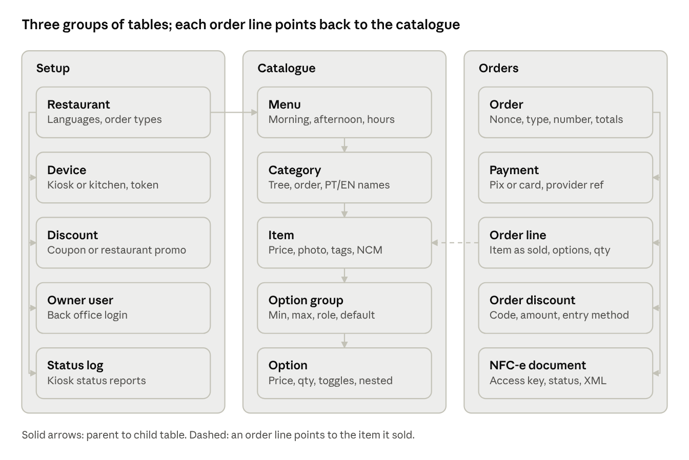
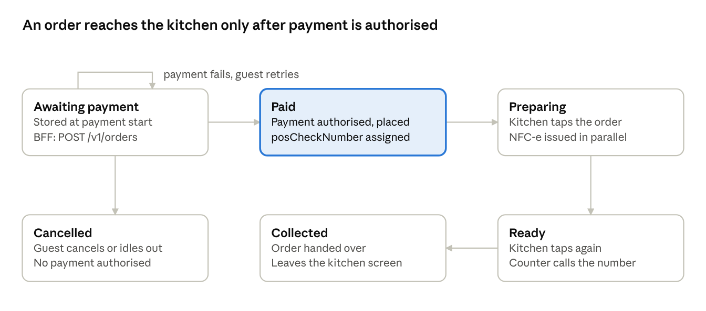

# Data model and cloud API

The Go API is the source of truth for menus, orders, payments and discounts. The kiosk is a **thin client**: Chromium on the board shows the Next.js app, and the Next.js server side (the **BFF**) answers the kiosk contract from the specs (the `OP-...` operations in `data-and-integrations.md`) by calling the Go API. As in the specs, the basket lives on the kiosk until payment starts.

## Who owns what

| Layer | Runs on | Owns | Built by |
| --- | --- | --- | --- |
| Kiosk screen | Orange Pi, Debian, Chromium in kiosk mode | Next.js pages as a PWA (service worker via Serwist); the basket while it is built (`orderItems`, `orderNonce`, `orderType`); idle timer; cached app shell for the "temporarily offline" screen | Kai |
| Kiosk BFF | Server, Next.js Route Handlers and Server Actions | The kiosk contract (`OP-...`); device session; one call per screen (config + menu + language together); receipt data for printing | Kai |
| Kitchen and back office | Server, Next.js; opened in a browser | Kitchen screen and back office, each with its own BFF routes | Kai |
| Core API | Server, Go | Business rules: prices, discounts, orders, order numbers, payments, NFC-e, devices, reports | Partner |
| Database | Server, PostgreSQL | Every table below; only the Go API touches it | Partner |

The BFF formats and combines; it never calculates prices, discounts, menu availability or order numbers. Those live only in Go, so there is one source of truth.

## Entities at a glance

Order lines copy the item's name and price at the moment of sale, so editing the catalogue never changes a past order or its NFC-e. Link tables (category to item, tags, cross-sell) are in the table below.

## Entity fields

Field names follow the specs wherever the spec defines one, so the local service can pass them through unchanged. Translatable text (names, descriptions, closed message) is stored as `{ "pt-BR": "...", "en": "..." }`.

| Table | Key fields | Serves spec entity |
| --- | --- | --- |
| `restaurant` | `id` (= `locationId`), `name`, `logo`, `defaultLanguage`, `supportedLanguages[]`, `isDineInAvailable`, `isTakeOutAvailable`, `closedMessage {title, description}`, `posCheckNumberDisplayLength`, `timezone`, `cnpj` | ENT-KIOSK-01 (brand config), ENT-KIOSK-03, ENT-START-02 |
| `device` | `id` (= `kioskID`), `kind` (kiosk or kitchen), `restaurantId, name, status, secretHash, appVersion, lastSeenAt, ip, screenResolution`, `idleTimerIntervalMilliseconds`, `printerEnabled`, `maintenanceMode`, `atCapacityMode` | ENT-KIOSK-01 |
| `device_status` | `deviceId`, `statusType`, `reason`, `category`, `message`, `at` | OP-KIOSK-04 payloads; heartbeats only update the device's lastSeenAt |
| `menu` | `id`, `name`, `currency`, `showCategoriesPrice` | ENT-MENU-01 |
| `menu_schedule` | `menuId`, `weekday`, `timeStart`, `timeEnd` (inverted = overnight) | Not in the specs; same window rule as ENT-START-01 |
| `category` | `id`, `menuId`, `parentId`, `name`, `image`, `displayOrder` | ENT-MENU-02 (`type` = CATEGORY) |
| `item` | `id`, `plu`, `name`, `shortName`, `description`, `image`, `price`, `servicePriceOverride`, `serviceAvailability`, `calories`, `itemLabels`, `defaultEntity`, `crossSellGroupId`, `soldOutDate`, fiscal fields (`ncm`, `cfop`, `taxes`) | ENT-MENU-02 (`type` = ITEM) |
| `category_item` | `categoryId`, `itemId`, `displayOrder`, `priceOverride` | Lets one item sit in both menus at different prices |
| `option_group` | `id`, `itemId` or `parentOptionId`, `name`, `role`, `minimum`, `maximum`, `defaultOption`, `displayOrder` | ENT-MENU-03 |
| `option` | `id`, `groupId`, `plu`, `name`, `price`, `servicePriceOverride`, `maximumQuantity`, `defaultQuantity`, `supersede`, `displayOrder` | ENT-MENU-04 |
| `composite_option` | `groupId, type (TOGGLE), positiveOption, negativeOption, defaultChoice` | ENT-MENU-05 (ingredient on/off, F-MENU-08) |
| `item_tag` | `id, badgeName, textColour, backgroundColour, tagsPages, scheduleEnabled, startDate, endDate` | ENT-MENU-06 (badges, F-MENU-05) |
| `item_tag_link` | `tagId, menuItemId or categoryId, enabled` | ENT-MENU-06 items\[\] |
| `cross_sell_group` | `id, name, crossSells[] (item ids)` | ENT-MENU-07 (F-MENU-11) |
| `discount` | `id`, `type` (Comanda coupon or RestaurantDiscount), `code`, `title`, `description`, `kind` (percent or fixed), `value`, `validFrom`, `validTo`, `active` | ENT-DISC-01 (definition side) |
| `order` | `id`, `orderNonce`, `restaurantId`, `deviceId`, `menuId`, `orderType`, `status`, `posCheckNumber`, `businessDate`, `subtotal`, `discountTotal`, `total`, `cpfCnpj`, `language`, `journeyStartedTimestamp`, `placedAt`, `readyAt` | ENT-BASKET-01, ENT-BASKET-02, ENT-POST-02 |
| `order_line` | `guid`, `orderId`, `itemId`, `name` and `unitPrice` as sold, `quantity`, `lineTotal` | ENT-BASKET-03 |
| `order_line_option` | `lineGuid`, `optionId`, `parentId`, `name` and `price` as sold, `quantity` | ENT-BASKET-03 `options[]` |
| `order_discount` | `orderId`, `discountId`, `type`, `value`, `entryMethod`, `title`, `amount` | ENT-DISC-01 (applied side) |
| `payment` | `id`, `orderId`, `method` (pix, credit, debit), `gatewayId`, `gatewayType`, `providerRef`, `amount`, `paymentStatus` | ENT-PAY-01 |
| `nfce` | `orderId`, `provider`, `status`, `accessKey`, `number`, `series`, `xmlUrl`, `danfeUrl`, `error` | Not in the specs |
| `journey_event` | `deviceId`, `orderNonce`, `type` (started, IDLE\_TIMEOUT, CANCELLED\_BY\_GUEST, reset), `orderTotal`, `at` | OP-START-01, OP-KIOSK-01, OP-KIOSK-02 |
| `owner_user` | `id`, `email`, `passwordHash` | Not in the specs (back office login) |

Not modelled, because their features are out of the MVP: age restriction and `verificationAge` (staff age approval), `barcodes` (Scan-and-Go), loyalty and awards, tips, donations, other payment methods. They can be added later as new columns or tables without changing these.

## Kiosk operations and the BFF

The kiosk screens keep the request and response shapes from the specs; the BFF answers each one by calling the Go API. Only the operations the MVP needs are listed.

| Spec operation | BFF does | Go API call | Phase |
| --- | --- | --- | --- |
| OP-KIOSK-06 Configuration load | Returns config + active menu + language pack in one response; kiosk retries every 5 s on failure (BR-KIOSK-02) | `GET /v1/devices/me/config`, `GET /v1/menus/active`, `GET /v1/languages/{code}` | 0 |
| OP-KIOSK-04 Status and actions | Forwards status and key actions; adds a heartbeat every few minutes | `POST /v1/devices/status`, `POST /v1/devices/heartbeat` | 0 |
| OP-START-01 Journey start | Returns `journeyStartedTimestamp` | `POST /v1/journeys` | 2 |
| OP-START-02 Language pack | Pack for the chosen language; kiosk falls back to its bundled pack | `GET /v1/languages/{code}` | 2 |
| OP-MENU-01 Fetch menu | Active menu in the ENT-MENU-01 shape, sold-out items removed | `GET /v1/menus/active?language=` | 2 |
| OP-BASKET-01 Order totals | Passes lines + order type + discount through, returns `orderTotal` | `POST /v1/quotes` | 2 |
| OP-DISC-01 / OP-DISC-04 Coupon and restaurant discount | Returns the discount item or the spec's error (invalid, already applied) | `POST /v1/discounts/validate` | 2 |
| OP-PAY-01 Payment authorise | Creates the order, then the payment | `POST /v1/orders`, `POST /v1/orders/{id}/payments` | 2 simulated, 4 real |
| OP-PAY-02 Payment status and cancel | Poll with 1 s minimum spacing; cancel | `GET /v1/payments/{id}`, `POST /v1/payments/{id}/cancel` | 2 simulated, 4 real |
| OP-PAY-03 Order placement | Sends `OrderRequest` (incl. CPF/CNPJ, OP-BASKET-04); returns `posCheckNumber`, `waitTime` | `POST /v1/orders/{id}/place` | 2 |
| OP-POST-03 Print receipt | Serves a receipt page; Chromium prints it without a dialog (`--kiosk-printing`, through CUPS) | none | 4 |
| OP-KIOSK-01 / 02, OP-START-03 Reset and abandon | Forwards reset, `IDLE_TIMEOUT`, `CANCELLED_BY_GUEST` | `POST /v1/journeys/{orderNonce}/events` | 2 |

Changed by the thin-client choice: OP-KIOSK-05 (printer status) is dropped, because a web page cannot query the printer; a failed print is reported by staff or by the device status. TEF with a USB PinPad is out, so payment is a cloud-integrated terminal or Pix on screen (see the MVP plan).

Not implemented because their features are out of scope: OP-KIOSK-03 (cash), 07 (admin panel), 08 (scanner), 09 (status terminals), OP-BASKET-02 and 03 (age approval), OP-DISC-02, 03, 05 (loyalty, senior, awards), OP-ALT-01 to 06, OP-POST-01, 02, 04, OP-SCO-01.

## Core API (Go)

The Go API is called only by the BFFs, never directly by a browser. It is a modular monolith (auth, devices, stores, catalog, orders, payments, admin) behind one REST/JSON interface, versioned under `/v1`. The full contract is contract/openapi.yaml (version 0.1.0, 66 operations, phases 0 to 3), and both sides generate code and types from it. Besides the tables below, it adds reading an order, a payment simulator for phases 2 and 3, owner login, image upload, device secret rotation and forcing a menu.

**Auth**

- **Device**: each device has a `deviceId` (e.g. `KIOSK-TBT-001`) and a `deviceSecret` set at provisioning. `POST /v1/devices/auth` exchanges them for a short-lived JWT. Disabling a device in the back office makes the API refuse its next auth, so a stolen kiosk stops working.
- **Owner**: email and password through the back office BFF, which keeps the session.
- **Providers**: payment and NFC-e webhooks, verified by signature, idempotent on the provider's reference.

**Devices**

| Method and path | Purpose |
| --- | --- |
| `POST /v1/devices/auth` | deviceId + deviceSecret to a short token |
| `GET /v1/devices/me/config` | Restaurant, device settings, `isOpen`, closed message |
| `POST /v1/devices/heartbeat` | `appVersion`, IP, screen resolution; updates `lastSeenAt` |
| `POST /v1/devices/status` | Status and key-action reports (OP-KIOSK-04) |

**Kiosk flow**

| Method and path | Purpose |
| --- | --- |
| `GET /v1/menus/active?language=` | Active menu in the ENT-MENU-01 shape |
| `GET /v1/languages/{code}` | Language pack override |
| `POST /v1/quotes` | Totals for lines + order type + discount, nothing stored |
| `POST /v1/discounts/validate` | Check a coupon or restaurant discount |
| `POST /v1/journeys`, `POST /v1/journeys/{orderNonce}/events` | Journey start, reset, abandon |
| `POST /v1/orders` | Store the order as `AWAITING_PAYMENT`, repriced server-side |
| `POST /v1/orders/{id}/payments`, `GET /v1/payments/{id}`, `POST /v1/payments/{id}/cancel` | Start, poll, cancel a payment |
| `POST /v1/orders/{id}/place` | Assign `posCheckNumber`, notify the kitchen, request NFC-e |

**Kitchen**

| Method and path | Purpose |
| --- | --- |
| `GET /v1/kitchen/orders?status=open` | Paid orders not yet collected, oldest first |
| `GET /v1/kitchen/stream` | Server-Sent Events for new orders and status changes; the kitchen BFF relays them to the browser |
| `POST /v1/kitchen/orders/{id}/status` | Move to `PREPARING`, `READY` or `COLLECTED` |

**Back office**

| Method and path | Purpose |
| --- | --- |
| `/v1/admin/restaurant`, `/v1/admin/devices` | Restaurant settings; create, disable and monitor devices (online, last seen, version) |
| `/v1/admin/menus`, `/v1/admin/menus/{id}/schedules` | Menus and opening windows; force a menu now |
| `/v1/admin/categories`, `/v1/admin/items`, `/v1/admin/option-groups`, `/v1/admin/tags`, `/v1/admin/cross-sells` | Catalogue CRUD, PT and EN text |
| `POST /v1/admin/items/{id}/sold-out` | Sold out for today |
| `/v1/admin/discounts` | Coupons and restaurant promotions |
| `GET /v1/admin/reports/daily?date=` | Orders, revenue, best sellers, average ticket |

**Webhooks (phase 4)**: `POST /v1/webhooks/payments/{provider}`, `POST /v1/webhooks/nfce/{provider}`.

## Rules

The cloud is the authority for prices, menus and order numbers; the kiosk only displays what the cloud returns.

**Menu by schedule**

- `GET /v1/menus/active` and `GET /v1/devices/me/config` evaluate `menu_schedule` in the restaurant's timezone. A window with `timeStart` later than `timeEnd` runs past midnight, the same rule the specs use for attract media (ENT-START-01).
- The back office forbids overlapping windows, so at most one menu is active. A forced menu from the back office wins until its end time.
- No active menu: `isOpen` = false, and the kiosk shows the specs' Lane Closed screen (BR-KIOSK-06, FR-109) with the restaurant's `closedMessage`, e.g. "Closed now, back at 06:00".
- The menu is loaded at journey start (OP-START-04), so a guest who started at 10:59 finishes on the morning menu.
- `isDineInAvailable` / `isTakeOutAvailable` = false removes that order type before the trading check, as in the specs.

**Totals (OP-BASKET-01)**

- Unit price = `category_item.priceOverride`, else `item.servicePriceOverride` for the order type, else `item.price`; plus each option's price (or its override) times its quantity.
- `subtotal` = sum of lines; `total` = `subtotal` minus `discountTotal`. Prices are tax-inclusive (`taxInclusive` = true); the tax line is filled in phase 4 with the NFC-e data.
- One discount per order. A second code asks to replace the first (the specs' replacement warning, SCR-DISC-05).
- `POST /v1/quotes` is for display only; `POST /v1/orders` reprices everything server-side.

**Order number**

- `posCheckNumber` is a sequence per restaurant per business day, assigned at `place` (FR-1010: the number comes from the placed-order response). Display follows BR-POST-01.

**Order status**

Only `Paid` orders reach the kitchen screen. A failed payment leaves the order in `Awaiting payment` so the guest can retry or pick another method; cancelling or idling out moves it to `Cancelled`.

## Open questions

The specs stop at the local service, so these are ours to decide before or during phase 0.

- [ ] **Price changed mid-order**: if the owner edits a price while a guest is ordering, does order creation keep the quoted price or reject and re-quote? Proposal: keep the price from the menu loaded at journey start.
- [ ] **`waitTime`**: the specs return it from order placement but do not say how it is computed. Fixed per restaurant, or from the kitchen queue?
- [ ] **Order number**: restart at 1 every business day? Which `posCheckNumberDisplayLength` (BR-POST-01)?
- [ ] **Cloud unreachable**: the PWA keeps the app shell cached; does the kiosk keep taking orders in an IndexedDB queue and sync later, or show "Order at the counter"? Proposal for the MVP: the counter screen.
- [ ] **Fiscal fields per item**: which tax fields the chosen NFC-e API needs (NCM, CFOP, tax situation codes, tax regime), to be confirmed with the accountant.
- [ ] **Device pairing**: code typed in the back office, or QR scanned from the kiosk?

Raised by the thin-client architecture:

- [ ] **Where the device secret lives**: with no local service, the secret has to be kept by the browser profile (e.g. an HttpOnly cookie set once at provisioning). Who provisions it, and how is it reset?
- [ ] **Printer on ARM**: does the chosen thermal printer have a CUPS driver that works on the board? Test at the start of the final phase, before buying.
