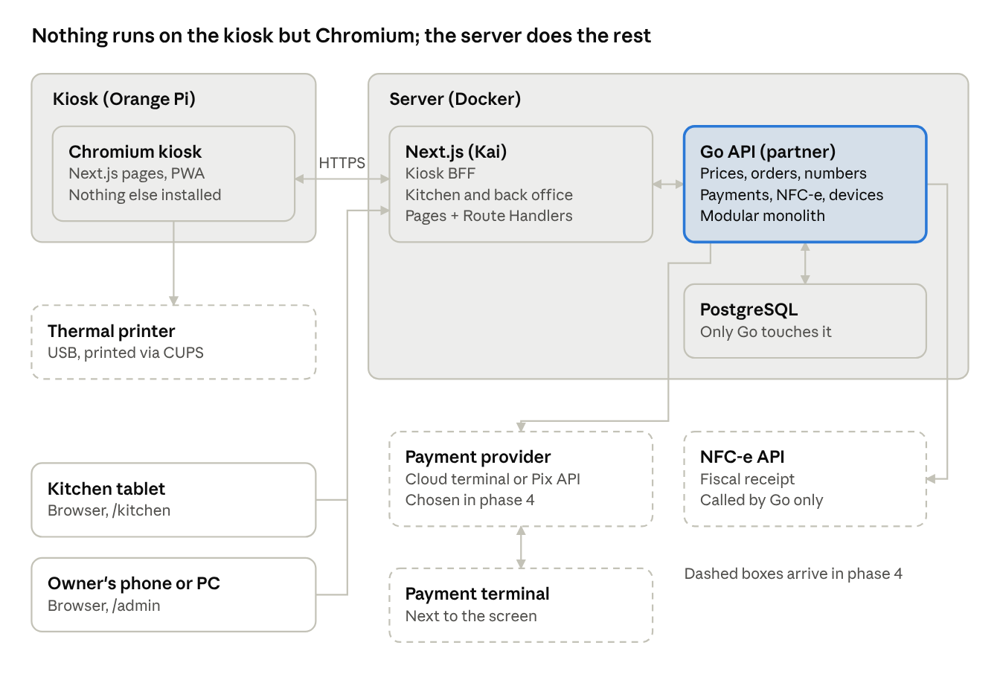
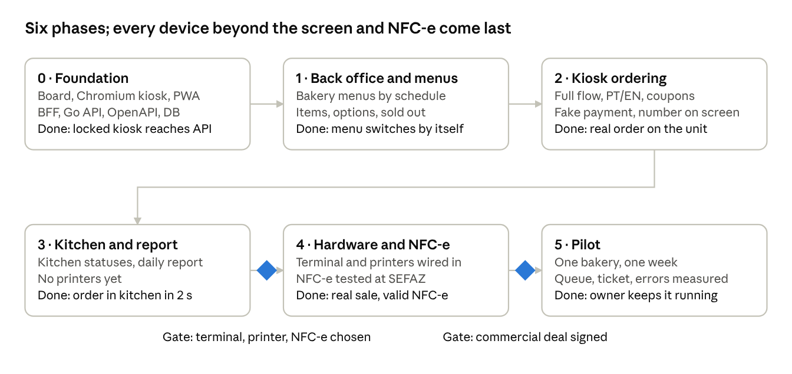

# Comanda — MVP implementation plan

Oct 29, 2026 · @Kai

## MVP scope

The MVP is a self-service kiosk for **a single bakery**, with **one visual template** (the "Café e trigo" theme from the prototype), plus a kitchen screen and a back office for the owner. The bakery is the first real test. The payment terminal, the receipt printer and NFC-e come last, in the same phase. "Restaurant" in the specs and the data model means the store.

The functional specs are the reference for kiosk behaviour. The brief excluded loyalty, Scan-and-Go with staff age approval, split bill, guest walks away and accessibility mode, and asked for one template and one restaurant. The other cuts in the right column (tips, other payment methods, digital receipts) are **our suggestion to keep the first version small**, to confirm with the partner.

| In the MVP | Out of scope |
| --- | --- |
| Attract screen, tap to start, Portuguese or English | Multi-brand, multiple templates |
| Eat in / Take away | Loyalty and loyalty rewards |
| Menu by category, item, options and add-ons, combos | Scan-and-Go and staff PIN age approval |
| Morning and afternoon menus (or one all-day menu), switching by schedule | Split bill |
| Basket with edit, remove, coupon codes and restaurant discounts, CPF/CNPJ on the receipt | Guest walks away flow |
| Idle warning and session reset | Accessibility mode |
| Order number on screen (printed receipt in the final phase) | Tips, donations, gift cards, cash, crypto, Face ID |
| Kitchen screen with order status | Email, SMS or QR receipts |
| Back office: menu, schedules, daily report | Technical admin panel and hardware telemetry |
| Payment terminal, receipt printer and NFC-e (final phase) | Order-ready display on a dining-room TV (candidate for phase 2) |

## Architecture

Comanda is a **thin-client kiosk** in front of a server: Chromium on the board only shows the Next.js app; the Next.js server side (Route Handlers and Server Actions, the **BFF**) talks to the **Go API**, which owns every business rule and the database. Nothing else is installed on the kiosk, so an update is a deploy on the server.

The kitchen screen and the back office are Next.js pages too, opened in a browser, each with its own BFF routes. The payment provider and the NFC-e API are called by the Go API, never by the kiosk. The BFF formats and combines data; prices, discounts, menu availability and order numbers are decided only in Go.

**Split of work**: Kai builds the Next.js app (screens and BFF); the partner builds the Go API and the database. The contract between them is an OpenAPI file: TypeScript types are generated from it, and a mock server from it lets the screens move ahead before the Go API is ready.

**Front end**: Next.js 16 with the App Router, chosen over SvelteKit on 30 Oct 2026 because Kai already ships Next.js every day. Next.js has no built-in offline caching; its [PWA guide](https://nextjs.org/docs/app/guides/progressive-web-apps) points to Serwist for the service worker that keeps the "temporarily offline" screen.

**Keeping the kiosk light** (the board is the weakest part):

- The menu loads once at journey start (OP-START-04) and stays in memory. Menu, item and cart are one client-side flow, so moving between them needs no server round trip until the quote.
- Attract, closed and success screens are Server Components. Client code is only the basket, the item builder and the idle timer, with the React Compiler on.
- Images go through `next/image`, sized for 1080 × 1920 and kept by the service worker after the first view.
- Tailwind (no CSS-in-JS runtime), fonts self-hosted with `next/font`, CSS transitions only, no animation library.
- Config and menu carry an `ETag`, so an unchanged menu costs the BFF a `304` from Go.
- The bundle is measured on the real board in phase 0 with the Next.js bundle analyzer.

Entities, rules and endpoints for the cloud side: [data-model-and-api.md](data-model-and-api.md)

## Menus by schedule

Menu modes are in, but they switch **automatically by schedule**, not by the owner tapping. Each menu has opening windows; the kiosk shows whichever is active now. The owner only steps in to force a switch, from the back office, never from the kiosk.

- **Menu** = a profile with a name and hours: Morning (06:00–11:00) and Afternoon (11:00–20:00). Hours are illustrative; the owner sets them. One all-day menu also works if the bakery prefers it.
- **Outside every window** (e.g. after 20:00) the kiosk shows "Closed now, back at 06:00".
- **Shared items**: coffee and drinks are registered once and linked to both menus. Price can differ per menu.
- **Order in progress at switch time**: a guest who started at 10:59 finishes on the morning menu.

Estimated size (an assumption for sizing, to confirm with the bakery):

| Menu | Categories | Items |
| --- | --- | --- |
| Morning | Breads, coffee, sandwiches, sweets, drinks | 25 to 35 |
| Afternoon | Savoury snacks, sandwiches, sweets, coffee, drinks | 25 to 35 |

At this size each category fits one screen without paging, and the first menu setup takes an afternoon.

## Kitchen screen

It is **the same application with a different login**: a `/kitchen` route open on a monitor or tablet in the kitchen, signed in as the kitchen device. A separate app is not worth it for the MVP: same code, deploy and database, only the screen changes.

How it works:

1. The order is paid at the kiosk and shows up in the kitchen within 2 seconds, with number, items, options and eat in or take away.
2. The kitchen taps the order: **New → Preparing → Ready**.
3. At Ready, the counter calls the number. An order-ready display on a dining-room TV comes after the MVP.

Product decisions for the MVP:

- **Real-time updates** via Server-Sent Events or polling every 2 s. Polling is enough for one bakery.
- **Kitchen printing is optional**: if the kitchen prefers paper, the same order prints on a thermal printer there, added in the final phase with the receipt printer. The screen stays the source of truth for status.
- **Order**: oldest first, with waiting time visible on each order.

## Back office

Yes, the back office is our CMS, and it lives **in the same application as an `/admin` area**, opened from the owner's phone or PC. It is **not** a mode inside the kiosk:

- The kiosk is a public screen. A hidden admin mode there is one lucky tap away from a customer changing prices.
- Editing a menu on a vertical 32" touch screen standing in the dining room is bad UX for the owner.
- One codebase still serves both: kiosk, kitchen and admin are three routes behind three kinds of login.

What the owner does there in the MVP:

| Area | What it covers |
| --- | --- |
| Menus | Create the menus (e.g. morning and afternoon), set opening hours, force a switch |
| Catalogue | Categories, items, photos, descriptions in Portuguese and English, prices per menu |
| Options | Option groups (min/max, required or optional), add-ons with price, combos |
| Availability | Mark an item sold out for today with one tap; it disappears from the kiosk |
| Daily report | Orders, revenue, best sellers, average ticket, per day |
| Settings | Restaurant name, logo, receipt footer, kiosk idle timeout |
| Discounts | Coupon codes and restaurant promotions, with validity dates |

Users and roles stay minimal: one owner account, plus device logins for the kiosk and the kitchen.

## Hardware and kiosk runtime

The kiosk is a **thin client**: a 15.6" touch screen in portrait, an ARM board (Orange Pi or Raspberry Pi) running Debian, and Chromium opening the Comanda URL full screen at boot. This replaces the reference specs' Windows + Electron + local service design; the specs still define how every screen behaves.

| Layer | Reference specs | Comanda |
| --- | --- | --- |
| Device | Windows PC | Orange Pi or Raspberry Pi, Debian |
| App runtime | Electron, frameless window, WiX installer | Chromium in kiosk mode opening the server URL |
| Lockdown | Shell Launcher | Autologin + Chromium inside a kiosk compositor (e.g. Cage); no desktop |
| Local service | Separate process on the kiosk | None; the BFF runs on the server |
| Updates | Reinstall on each device | Deploy on the server; kiosks pick it up on reload |
| Offline | The local service answers | The PWA caches the app shell; the MVP shows "temporarily offline" |
| Printing | Local service drives the printer | Chromium prints without a dialog (`--kiosk-printing`) through CUPS |
| Payment terminal | PED through the local service | Cloud-integrated terminal or Pix on screen; TEF with a USB PinPad is ruled out |

At boot: power on, Debian starts, autologin, Chromium opens `https://kiosk.<domain>` in kiosk mode, and the device's credentials sign it in. The guest never sees a desktop or a browser.

Open points to confirm before buying hardware:

- [ ] Board model: run the prototype on the real board in phase 0 before buying more. Chromium's GPU acceleration on ARM varies by board; Raspberry Pi has wider community support for kiosks.
- [ ] Thermal printer with a CUPS driver that works on ARM, tested on the board at the start of the final phase.
- [ ] Screen: 15.6" touch in portrait, 1080 × 1920 (the prototype is drawn at 9:16).
- [ ] Provisioning: how each board gets its `deviceId` and secret, and how it is reset.

## Phases

The MVP ships in six phases, each with one clear "done when". Phases 0 to 3 need no decision from the owner; phase 4 adds every device beyond the screen (payment terminal, receipt and kitchen printers) plus NFC-e, and waits for him to choose the payment option and the NFC-e API.

Which spec features each phase implements (IDs from `feature-checklist.md`). Only what the brief kept is listed; sub-items tied to excluded features (loyalty, Scan-and-Go, accessibility, brand variants) are skipped.

| Phase | Spec features | Not in the specs |
| --- | --- | --- |
| 0 · Foundation | F-KIOSK-01 start-up and loading, F-KIOSK-09 replaced by Chromium kiosk on Debian (no installer) | Go API, database, BFF, device auth and heartbeat |
| 1 · Back office and menus | Menu data follows ENT-MENU-01 to 07 | Back office screens, menu schedules |
| 2 · Kiosk ordering | F-START-01, F-START-03, F-START-04, F-START-07, F-MENU-01 to 13, F-BASKET-01 to 04 and 10, F-KIOSK-02 to 04, F-POST-01, F-POST-05, F-DISC-01, 02, 04 to 06 (coupon codes and restaurant discounts only, no loyalty parts) | Simulated payment; order number on screen, nothing printed |
| 3 · Kitchen and report | none | Kitchen screen, daily report |
| 4 · Hardware and NFC-e | F-PAY-01 to 03, F-PAY-07, F-POST-03 (printed receipt); discounts carried onto the NFC-e | Cloud-integrated terminal or Pix on screen, receipt and kitchen printers, NFC-e |
| 5 · Pilot | none | Measurements with the bakery |

## Payment, printer and NFC-e (final phase)

Payment, the receipt printer and NFC-e ship together in the last build phase, because a paid order must end in a fiscal receipt the guest can take. Until then the kiosk uses a **simulated payment** and shows the order number on screen, so the whole flow, kitchen included, can be tested end to end. The options below are a shortlist to evaluate, **not yet checked against each provider's docs**.

**Payment options**

| Option | How it works | Local software on the kiosk | Notes |
| --- | --- | --- | --- |
| Cloud-integrated terminal (e.g. Mercado Pago Point, Stone) | Our backend sends the charge over the internet; it appears on the terminal | No | Simplest integration; one acquirer; Mercado Pago announced an Orders API for Point in 2025 and Stone has a product called Stone Connect, both to be read |
| TEF with USB PinPad (e.g. SiTef, PayGo) | A TEF client on Windows talks to the PinPad and the acquirers | Yes | Ruled out: it needs software installed on the kiosk, which the thin-client design avoids (and TEF clients likely have no ARM build) |
| Pix QR on the kiosk screen | Backend creates a dynamic Pix charge through a bank or PSP API; guest pays from their phone | No | No terminal needed for Pix; usually lowest fees; cards still need one of the rows above |

**NFC-e**

NFC-e is issued through a **third-party API**, never built by hand. Candidates to compare: Focus NFe, NFE.io, TecnoSpeed. In São Paulo, NFC-e is the only consumer receipt model since 1 January 2026 (SAT was discontinued).

What the bakery needs before go-live, with its accountant:

- [ ] Digital certificate (A1) for the bakery's CNPJ
- [ ] NFC-e credentialing at SEFAZ-SP and the CSC token
- [ ] Tax setup per item (NCM, CFOP, tax regime) loaded into the back office
- [ ] Confirmation that the chosen API is up to date with the tax-reform fields

The decision on which payment row to pick belongs to the owner: it depends on the acquirer he already uses and the fees he pays.

## Open decisions and risks

Most of these block the final phase; none blocks starting phase 1.

**Decisions for the owner**

- [ ] Which payment option (cloud-integrated terminal or Pix on screen), based on his current acquirer and fees
- [ ] Which NFC-e API, after a price and docs comparison
- [ ] Bakery menu: real items, prices, photos and opening hours
- [ ] Commercial model with the bakery, agreed before the pilot (e.g. monthly fee per kiosk)

**Risks**

| Risk | Impact | Mitigation |
| --- | --- | --- |
| Internet drops during service | Kiosk cannot take paid orders | "Order at the counter" screen; NFC-e offline contingency later |
| Fiscal setup takes weeks (certificate, SEFAZ, accountant) | Final phase slips | Start the paperwork during phase 1, not at the end |
| Kitchen ignores the screen | Orders get lost | Optional kitchen printer; pilot week with someone on site |
| Scope creep from the full spec | MVP never ships | Anything not in the scope table needs an explicit yes from both partners |
| Board too slow for Chromium, or printer without an ARM driver | Laggy screens or no receipts | Test the prototype on the real board in phase 0 and the printer at the start of phase 4, before buying more. Keep client components few and check the Next.js bundle size there, since React ships more JavaScript than Svelte |
